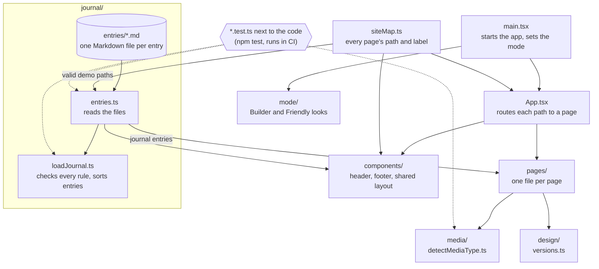

# learning-experimentation

I use this public repository to build my understanding of software development by trying ideas in small projects. I write down what I tried, what worked, and what I would do differently so others can reproduce the experiments and use what we learn in their own projects.

The website is my development journal: https://git-ebrahim.github.io/learning-experimentation/. The **Journal** page has one entry per experiment, covering the question, the approach, the findings, and the evidence. Each entry links to its pull requests and to the page on the site that shows it working. The entries are Markdown files in [`web/src/journal/entries/`](web/src/journal/entries/), so they can be read on GitHub too.

## First project

Build a small website people can use at a public URL. React provides the interface, Vite builds the frontend for GitHub Pages, and NestJS provides the API from a separate Node.js host. GitHub Pages serves static files, so the deployed React app will call the NestJS API over HTTPS. [GitHub Pages documentation](https://docs.github.com/en/pages/getting-started-with-github-pages/what-is-github-pages)

The project is in progress. The frontend is live. Follow the [first experiment](web/src/journal/entries/001-react-site-with-nestjs-api.md) for milestones and findings.

## How the code is organised

Everything for the website is in [`web/`](web/). Words such as *entry*, *demo*, and *site map* are defined in [`GLOSSARY.md`](GLOSSARY.md).

Every pull request runs lint, the tests, and a build. Merging to `main` deploys the site to GitHub Pages ([workflow](.github/workflows/deploy-pages.yml)).

## How it's built

I build this site with help from AI coding tools. I review and merge every change myself.
