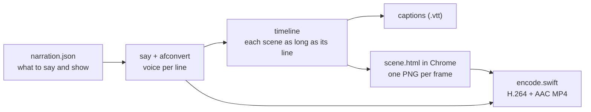

# How-to video

Builds `src/assets/howto/terminal-to-claude-code.mp4`, plus its captions (`.vtt`) and poster image (`-poster.jpg`), for the **Media** page.



## Rebuild it

From `web/`, on a Mac with Google Chrome:

```sh
npm run video
```

It takes about two minutes. Set `KEEP_FRAMES=1` to keep the frame images, so you can check them.

## Change it

- **Words:** edit `narration.json`. `speech` is what the voice says, and `caption` is what the captions show. They differ where spelling things out helps the voice ("C D", "tilde"). `typeAt` and `enterAt` set when typing starts and when Return is pressed, as a fraction of the line.
- **Picture:** edit `scene.html`. `renderAt(t)` draws the frame at `t` seconds. Open the file in a browser and call `setTimeline(...)` and `renderAt(...)` from the console to try changes.
- **Voice, frame rate, or quality:** see the constants at the top of `build.mjs`.

## Why it's built this way

- **Every frame is drawn from the time alone,** so the video comes out the same on every run, and the typing always matches the voice.
- **Only tools that ship with macOS** (`say`, `afconvert`, Swift with AVFoundation), plus Chrome. There's no ffmpeg to install.
- **H.264 video and AAC audio in an MP4** play in every current browser.
